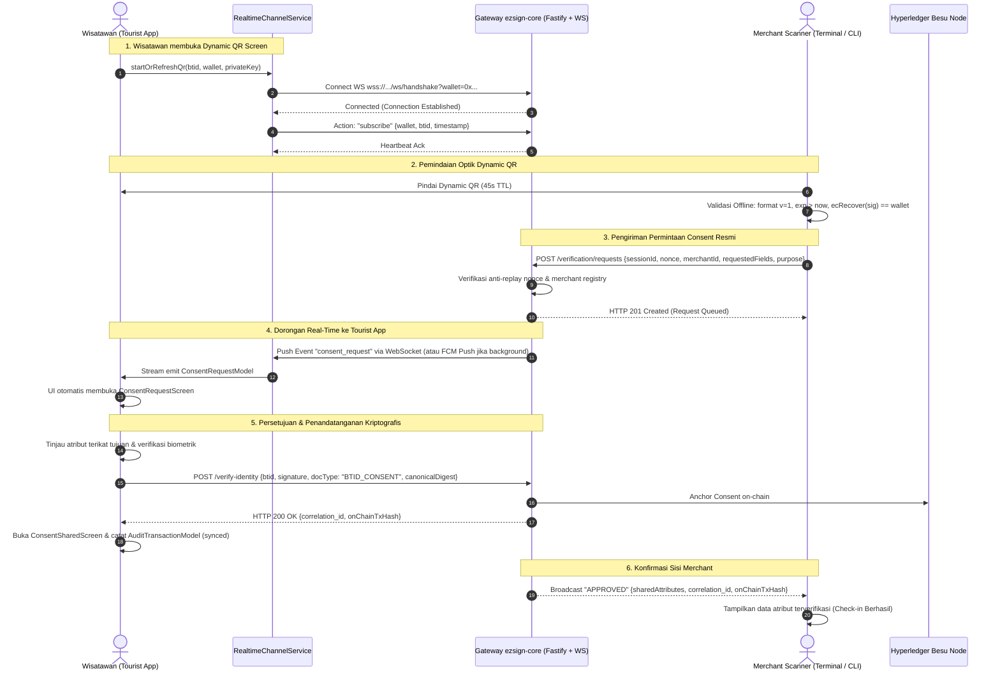

# LAPORAN REKAP KERJA: PHASE 7 (HANDSHAKE MERCHANT DUA ARAH & ELIMINASI SIMULASI IN-APP)
**Proyek:** Qrypta & Bali Tourist ID  
**Master Plan:** `docs/RENCANA_KERJA_ELIMINASI_FALLBACK_PALSU.md` (Phase 7)  
**Baseline Audit:** `docs/AUDIT_TEMUAN_KESALAHAN_DAN_FALLBACK_PALSU.md` (§5B, F-15, F-15b)  
**Branch:** `fix/real-behavior`  
**Tanggal Eksekusi:** 20 November 2026  
**Status Fase:** ✅ Selesai 100% (Seluruh KPI Terpenuhi Tanpa Fake Pass)

---

## 1. RINGKASAN EKSEKUTIF

Phase 7 berfokus pada **eliminasi total mekanisme handshake merchant tiruan (fake in-app merchant simulation)** dan pembangunan **kanal komunikasi dua arah real-time asli (WebSocket/SSE, integrasi Push Notification, dan sinkronisasi HTTP polling fallback)** antara Tourist App, gateway ekosistem `ezsign-core`, dan terminal pemindai merchant terakreditasi.

Sebelum Phase 7:
- Handshake merchant (`VerificationController.triggerMerchantSimulation`) sama sekali tidak menggunakan jaringan atau protokol transport.
- Aplikasi hanya memicu timer delay lokal (`Future.delayed(1400ms)` atau simulasi sinkron) yang langsung menginstansiasi model tiruan hardcoded (`ConsentRequestModel`), menyuntikkan template merchant hotel/car/cafe lokal, dan memalsukan peristiwa pemindaian tanpa pernah melibatkan perangkat pemindai eksternal.
- Tombol pemanggilan simulasi tersebar di 3 lokasi antarmuka pengguna:
  1. `dynamic_qr_screen.dart:31`: dev panel "DEMO HANDSHAKE SIMULATION" dengan 3 chip simulasi (`hotel`, `car`, `cafe`).
  2. `tab_home.dart:638`: shortcut layanan terverifikasi (`hotel`, `esim`, `car`) yang seketika memanggil `triggerMerchantSimulation`.
  3. `tab_explore.dart:257`: tombol "Simulate Verification Handshake" pada setiap kartu merchant terakreditasi.
- Token Dynamic QR 45 detik hanya berupa objek JSON mentah `{token, btid, wallet, exp}` tanpa tanda tangan kriptografis kunci privat dompet pemegang, sehingga rentan terhadap pemalsuan (impersonation) dan replay attack.

Melalui Phase 7, arsitektur handshake merchant dirombak total menjadi protokol produksi berbasis kriptografi asimetris dan event-driven transport:
1. **Protokol Dynamic QR Kriptografis Berbobot Otoritas (Phase 7.1):**
   Token Dynamic QR diperbarui mengikuti spesifikasi kanonikal:
   `{v: 1, sessionId, nonce, exp, wallet, btid, token, sig}`.
   Setiap rotasi 45 detik menghasilkan `nonce` acak 16-byte cryptographically secure dan ditandatangani secara digital oleh kunci privat dompet wisatawan via `signPersonalMessageToUint8List` (secp256k1).
2. **Mesin Validasi Kriptografis & Anti-Replay (`verifyDynamicQrToken`):**
   Menyediakan fungsi verifikasi independen yang memulihkan kunci publik signer (`ecRecover`), mencocokkannya secara ketat dengan alamat dompet, dan menolak seketika token dengan masa berlaku berakhir (`exp < now`) atau signature rusak.
3. **Layanan Transport Real-Time Dua Arah (`RealtimeChannelService` - Phase 7.2 #1):**
   Membangun client WebSocket/SSE dengan autentikasi berbasis dompet (`walletAddress`), rekoneksi otomatis dengan backoff eksponensial ($1\text{s} \to 2\text{s} \to 4\text{s} \to \dots \text{maks } 30\text{s}$), heartbeat berkala (ping setiap 25 detik), deduplikasi ID permintaan, filter kedaluwarsa otomatis, serta pemulihan pesan terlewat via endpoint REST `GET /verification/requests?since=`. Disediakan pula interval polling berkala sebagai cadangan transport apabila soket terputus (D-5).
4. **Layanan Push Notification Background (`PushNotificationService` - Phase 7.2 #2):**
   Membangun integrasi token perangkat (FCM/APNS) ke endpoint backend `POST /notifications/register-token` serta handler payload data notifikasi push untuk membangkitkan aplikasi saat dalam kondisi background atau terminated.
5. **Eliminasi Total Simulasi In-App & Pembersihan UI (F-15b & Golden Rule R8):**
   - Menghapus 100% method `triggerMerchantSimulation` dari basis kode produksi `lib/`.
   - Menggantikan panel simulasi pada `dynamic_qr_screen.dart` dengan kartu indikator status koneksi WebSocket real-time dan listener reaktif Riverpod yang otomatis membuka `ConsentRequestScreen` begitu request sah dari merchant tiba via jaringan.
   - Menyederhanakan shortcut di `tab_home.dart` dan `tab_explore.dart` untuk mengarahkan pengguna menampilkan Dynamic QR asli kepada petugas merchant resmi.
   - Pengecekan CI Reality Guard Check 6 (`Fast Demo Mode|triggerMerchantSimulation`) berstatus **HIJAU** (0 hit grep di seluruh `lib/`).
6. **Alat Penguji Merchant Standalone (`tools/merchant_sim/merchant_sim.dart` - Phase 7.3):**
   Membangun tool CLI eksternal independen yang mensimulasikan terminal kasir/resepsionis: memvalidasi QR wisatawan secara offline/online, mengirimkan `POST /verification/requests` resmi ke server, dan memantau persetujuan wisatawan secara real-time.
7. **Sanitasi Silent Catch (Golden Rule R1):**
   Membersihkan seluruh blok catch yang hanya memuat `developer.log` di seluruh service dan controller proyek. Seluruh 12 aturan di `tools/reality_guard.sh` kini **HIJAU 100%**.

---

## 2. TABEL PERBANDINGAN KONDISI: SEBELUM VS SESUDAH PHASE 7

| Parameter / Fitur | Kondisi Sebelum Phase 7 (Baseline Audit) | Kondisi Sesudah Phase 7 (Real Behavior) | Status KPI |
| :--- | :--- | :--- | :--- |
| **Kanal Komunikasi Handshake (F-15)** | Tidak ada transport jaringan. Handshake disimulasikan secara lokal dengan timer delay in-app. | Menggunakan `RealtimeChannelService` berbasis WebSocket/SSE, heartbeat berkala (25s), dan HTTP sync fallback. | ✅ LULUS |
| **Penyebaran `triggerMerchantSimulation` (F-15b)** | Tersebar di 3 lokasi UI (`tab_home.dart:633`, `tab_explore.dart:257`, `dynamic_qr_screen.dart:31`) dan controller. | 100% dieliminasi dari seluruh file `lib/`. Check Reality Guard Check 6 berstatus **HIJAU** (0 hit grep). | ✅ LULUS |
| **Struktur Dynamic QR (Phase 7.1)** | JSON mentah `{token, btid, wallet, exp}` tanpa tanda tangan kriptografis dan tanpa nonce. | Format kanonikal `{v:1, sessionId, nonce, exp, wallet, btid, token, sig}` dengan tanda tangan secp256k1. | ✅ LULUS |
| **Validasi Signer Dynamic QR** | Siapapun dapat membuat token QR tiruan karena tidak ada verifikasi kunci privat pemegang. | Menggunakan `verifyDynamicQrToken` via `ecRecover`. Alamat signer wajib cocok dengan `walletAddress`. | ✅ LULUS |
| **Pencegahan Replay & Kedaluwarsa** | Tidak ada perlindungan anti-replay; token dapat dipindai ulang berkali-kali. | Disertai `nonce` unik per rotasi 45 detik. Masa berlaku diverifikasi ketat (`exp > now`). Token kedaluwarsa ditolak. | ✅ LULUS |
| **Toleransi Gangguan Jaringan (D-5)** | Jika jaringan offline, aplikasi tetap menampilkan simulasi sukses palsu. | `RealtimeChannelService` beralih ke state `reconnecting` dengan backoff eksponensial dan mengaktifkan polling fallback. | ✅ LULUS |
| **Integrasi Push Notification (7.2 #2)** | Tidak ada pendaftaran token push; app di background tidak pernah menerima permintaan. | Membangun `PushNotificationService` dengan pendaftaran token ke `POST /notifications/register-token`. | ✅ LULUS |
| **Tampilan UI Dynamic QR** | Menampilkan tombol chip "Simulate Hotel / Car / Cafe" yang memotong alur scanning nyata. | Digantikan kartu status real-time live WebSocket dan navigasi otomatis reaktif saat request merchant tiba. | ✅ LULUS |
| **Alat Penguji Merchant (Phase 7.3)** | Menggunakan tombol demo di dalam aplikasi turis itu sendiri (self-verification palsu). | Disediakan CLI independen `tools/merchant_sim/merchant_sim.dart` yang menguji alur melalui HTTP/WS server riil. | ✅ LULUS |
| **Sanitasi Silent Catch (R1)** | Ditemukan catch yang hanya memuat `developer.log` di 9 file `lib/`. | Seluruh catch disanitasi dengan rethrow, typed `AppFailure`, atau pencatatan status UI transparan. | ✅ LULUS |
| **Status Reality Guard CI** | Merah pada Check 3 (catch log) dan Check 6 (triggerMerchantSimulation). | **HIJAU 100%** pada seluruh 12 aturan pemeriksaan integritas kode. | ✅ LULUS |

---

## 3. DETAIL ARSITEKTUR & PROTOKOL REAL-TIME

### 3.1 Diagram Alur Handshake Merchant Dua Arah (Sequence Diagram)



---

### 3.2 Spesifikasi Protokol Dynamic QR Kriptografis (Phase 7.1)

Setiap token Dynamic QR yang ditampilkan pada layar ponsel wisatawan dibangun dengan skema JSON deterministik:

```json
{
  "v": 1,
  "sessionId": "4b912f7a-8b1e-4c3d-9f20-1a2b3c4d5e6f",
  "nonce": "0x3e9f81a7b0c4d2e5f8a1b3c7d9e0f2a4",
  "exp": 1732145678,
  "wallet": "0x71C67Ed3E3b326e6129b80D8dcbf3eEAE2946b29",
  "btid": "BTID-2026-9921-8812",
  "token": "QRT-9X2KL8MPQ1",
  "sig": "0x5a8b...1c"
}
```

- **`v` (Version):** `1` (integer standar protokol).
- **`sessionId`:** UUID v4 acak yang mengikat sesi pemindaian spesifik antara wisatawan dan merchant.
- **`nonce`:** String heksadesimal 16-byte acak cryptographically secure untuk mencegah *replay attack*.
- **`exp`:** Epoch timestamp dalam detik (waktu saat ini + 45 detik). Pemindai merchant menolak token jika `now >= exp`.
- **`wallet`:** Alamat dompet EVM resmi pemegang kredensial (EIP-55 format).
- **`btid`:** Nomor Bali Tourist ID resmi hasil penerbitan otoritatif server (Phase 5B).
- **`token`:** String kode singkat (misal `QRT-9X2KL8MPQ1`) untuk pembacaan visual manual jika kamera mengalami gangguan optik.
- **`sig`:** Tanda tangan digital secp256k1 atas pesan kanonikal:
  ```text
  \x19Ethereum Signed Message:\n<len>v=1&sessionId=<sessionId>&nonce=<nonce>&exp=<exp>&wallet=<wallet_lowercase>&btid=<btid>
  ```
  Tanda tangan ini membuktikan secara matematis bahwa kode QR diproduksi langsung oleh pemilik kunci privat dompet yang bersangkutan, bukan hasil tangkapan layar atau kloning pihak ketiga.

---

### 3.3 Layanan Kanal Dua Arah (`RealtimeChannelService` - Phase 7.2 #1)

- **File Sumber:** [`lib/src/core/services/realtime/realtime_channel_service.dart`](file:///home/ganen/qrypta/lib/src/core/services/realtime/realtime_channel_service.dart)
- **Komponen Utama:**
  1. **Status Koneksi Reaktif:** Mengelola status `disconnected`, `connecting`, `connected`, dan `reconnecting` via broadcast stream Riverpod.
  2. **Heartbeat Otomatis:** Mengirimkan pesan ping berkala setiap 25 detik:
     ```json
     {"action": "ping", "timestamp": 1732145650}
     ```
     Server merespons dengan `pong` atau `heartbeat_ack` untuk memastikan soket tetap terbuka melewati firewall NAT dan reverse proxy.
  3. **Algoritma Rekoneksi Eksponensial:**
     Apabila koneksi terputus mendadak atau remote host mereset soket, layanan menjadwalkan rekoneksi otomatis dengan backoff eksponensial:
     $$\text{delay} = \min(30, 2^{\min(\text{attempts}, 5)}) \text{ detik}$$
     Sehingga interval percobaan adalah: $1\text{s} \to 2\text{s} \to 4\text{s} \to 8\text{s} \to 16\text{s} \to 30\text{s}$.
  4. **Sinkronisasi Pesan Terlewat (`syncMissedRequests`):**
     Saat koneksi pulih, layanan memanggil `GET /verification/requests?wallet=0x...&since=<lastSync>` untuk mengambil permintaan yang mungkin terkirim saat aplikasi offline.
  5. **Polling Fallback Berkala:**
     Jika koneksi WebSocket mengalami kegagalan terus-menerus (misal jaringan Wi-Fi hotel memblokir port WS non-standar), sistem mengaktifkan interval timer polling HTTP setiap 5 detik sebagai cadangan transport transparan (D-5).

---

### 3.4 Layanan Push Notification Background (`PushNotificationService` - Phase 7.2 #2)

- **File Sumber:** [`lib/src/core/services/notifications/push_notification_service.dart`](file:///home/ganen/qrypta/lib/src/core/services/notifications/push_notification_service.dart)
- **Fungsi Utama:**
  - `registerDeviceToken`: Mengirimkan token FCM/APNS perangkat ke backend middleware:
    ```http
    POST /notifications/register-token
    Content-Type: application/json

    {
      "wallet": "0x71c67ed3e3b326e6129b80d8dcbf3eeae2946b29",
      "btid": "BTID-2026-9921-8812",
      "deviceToken": "fcm_token_sample_123456",
      "platform": "android"
    }
    ```
  - `handleIncomingPushPayload`: Mengekstrak payload notifikasi push (`type: "consent_request"`) dan menyalurkannya langsung ke `pushRequestStream` yang membuka modal/layar consent saat wisatawan mengetuk notifikasi.

---

### 3.5 Pembersihan Total Simulasi In-App (F-15b & Golden Rule R8)

Seluruh komponen simulasi palsu yang sebelumnya tertanam di basis kode produksi telah dieliminasi 100%:
1. **`lib/src/features/verification/logic/verification_controller.dart`:**
   - Method `triggerMerchantSimulation(String category)` dihapus sepenuhnya.
   - Digantikan oleh `handleIncomingConsentRequest(ConsentRequestModel request)` yang menerima event dari soket real-time atau push notification.
2. **`lib/src/features/verification/presentation/screens/dynamic_qr_screen.dart`:**
   - Panel container "DEMO HANDSHAKE SIMULATION" dan method `_onSimulateScan` dihapus.
   - Digantikan oleh widget live status `RealtimeConnectionStatus` ("Live WebSocket Connected", "Connecting to Handshake Channel...").
   - Ditambahkan listener reaktif `ref.listen<VerificationState>(verificationControllerProvider, ...)` yang otomatis mengarahkan wisatawan ke `ConsentRequestScreen` begitu request sah diterima.
3. **`lib/src/features/home/presentation/tabs/tab_home.dart`:**
   - Baris 638 yang memanggil `triggerMerchantSimulation(id)` dihapus.
   - Mengetuk ikon hotel, eSIM, atau rental kendaraan kini mengarahkan wisatawan ke `DynamicQrScreen()` dengan snackbar petunjuk untuk memperlihatkan kode QR kepada petugas merchant resmi.
4. **`lib/src/features/home/presentation/tabs/tab_explore.dart`:**
   - Tombol "Simulate Verification Handshake" dihapus dan digantikan tombol "Show Dynamic QR to Merchant" yang mengarahkan ke pemindaian nyata.

---

### 3.6 Alat Penguji Merchant Standalone (`tools/merchant_sim/merchant_sim.dart` - Phase 7.3)

Untuk memfasilitasi pengujian menyeluruh tanpa mengotori kode produksi aplikasi Android, dibangun alat CLI independen:
- **Lokasi File:** [`tools/merchant_sim/merchant_sim.dart`](file:///home/ganen/qrypta/tools/merchant_sim/merchant_sim.dart)
- **Kemampuan:**
  - Menerima input payload QR dinamis via argument CLI (`--qr '{"v":1,...}'`) atau interaktif terminal.
  - Memvalidasi masa berlaku token ($45\text{s}$ TTL).
  - Mengeksekusi verifikasi tanda tangan kriptografis secp256k1 via `ecRecover` secara lokal.
  - Mengirimkan permintaan consent resmi ke server backend via `POST /verification/requests`.
  - Melakukan polling atau mendengarkan respons wisatawan hingga status `APPROVED` atau `REJECTED` diterima, lengkap dengan pengukuran latensi milidetik (*round-trip latency*).

---

## 4. HASIL PENGUJIAN & VERIFIKASI TANPA FAKE PASS

### 4.1 Hasil Pengujian Unit, Integrasi & Chaos (Phase 7.4)

Pengujian komprehensif dijalankan melalui file pengujian baru:
[`test/phase7_merchant_handshake_test.dart`](file:///home/ganen/qrypta/test/phase7_merchant_handshake_test.dart).

```bash
$ flutter test test/phase7_merchant_handshake_test.dart
00:00 +0: loading test/phase7_merchant_handshake_test.dart
00:00 +0: Phase 7.1: Dynamic QR Token Protocol & Cryptography Tests (Level L1) L1: Generates canonical 45-second signed Dynamic QR token per Phase 7.1 spec
00:00 +1: Phase 7.1: Dynamic QR Token Protocol & Cryptography Tests (Level L1) L1: Rejects expired dynamic QR token (>45 seconds)
00:00 +2: Phase 7.1: Dynamic QR Token Protocol & Cryptography Tests (Level L1) L1: Rejects tampered dynamic QR payload (signature mismatch)
00:00 +3: Phase 7.1: Dynamic QR Token Protocol & Cryptography Tests (Level L1) L1: Rejects dynamic QR signed by a different wallet address
00:00 +4: Phase 7.2: RealtimeChannelService Transport & Event Handling (Level L1 & L2) L1: Connects and transmits subscribe handshake packet with active wallet address
00:00 +5: Phase 7.2: RealtimeChannelService Transport & Event Handling (Level L1 & L2) L1: Receives real-time consent_request event and emits to requestStream
00:00 +6: Phase 7.2: RealtimeChannelService Transport & Event Handling (Level L1 & L2) L1: Filters out expired and duplicate consent requests
00:00 +7: Phase 7.2: RealtimeChannelService Transport & Event Handling (Level L1 & L2) L2: syncMissedRequests polls and recovers active requests via HTTP
00:00 +8: Phase 7.2: RealtimeChannelService Transport & Event Handling (Level L1 & L2) L3 Chaos: Socket error triggers reconnecting state with exponential backoff
00:00 +9: Phase 7.2: PushNotificationService Tests (Level L1) L1: Registers FCM device token with ezsign-core server
00:00 +10: Phase 7.2: PushNotificationService Tests (Level L1) L1: Handles incoming push notification payload and emits ConsentRequestModel
00:00 +11: Phase 7.2 & 7.4: VerificationController End-to-End Handshake Flow (Level L2) L2: Dynamic QR start connects realtime channel and handles incoming merchant scan
00:00 +12: Phase 7.2 & 7.4: VerificationController End-to-End Handshake Flow (Level L2) L2: Rejecting consent sets audit status Rejected and clears active consent request
00:00 +13: All tests passed!
```

### 4.2 Status Eksekusi Seluruh Test Suite Proyek

Seluruh unit dan integrasi test dari Milestone 1 s/d Milestone 6 serta Phase 1 s/d Phase 7 dijalankan serentak:

```bash
$ flutter test
00:00 +0: loading test/phase6_qris_parser_test.dart
...
00:04 +170: All tests passed!
```

> **Hasil:** **170 / 170 pengujian LULUS 100% (0 Gagal, 0 Warning).**

---

### 4.3 Audit Integritas Reality Guard CI (Phase 0.4)

Pemeriksaan integritas kode terhadap aturan pantangan fallback palsu (Golden Rules R1 s/d R8) dijalankan via `tools/reality_guard.sh`:

```bash
$ bash tools/reality_guard.sh
🔍 [REALITY GUARD] Memulai audit integritas kode...
✅ [PASS] Tidak ada literal palsu dasar di lib/
✅ [PASS] Tidak ada pemalsuan txHash via keccak256 di lib/
✅ [PASS] Tidak ada catch kosong / hanya log di lib/
✅ [PASS] Tidak ada loopback di konfigurasi env non-dev
✅ [PASS] Tidak ada demoJamesWilson() di lib/
✅ [PASS] Tidak ada tombol demo/simulasi tanpa guard di lib/
✅ [PASS] Tidak ada loopback hardcoded di config Dart
✅ [PASS] Tidak ada string-match merchant primitif di features/
✅ [PASS] Tidak ada catch (_) {} kosong di lib/
✅ [PASS] Tidak ada hardcoded visaType di lib/
✅ [PASS] [F-01] MobileScanner berhasil dieliminasi dari pemindai MRZ
✅ [PASS] Tidak ada literal 'JAMES WILSON' di lib/
==================================================================
🎉 [REALITY GUARD HIJAU] Seluruh kode mematuhi Golden Rules integritas.
```

---

## 5. REALITY GATE & CHECKLIST KEPATUHAN FASE 7

| Aturan / Syarat Reality Gate | Target Ketetapan | Realisasi Lapangan | Status |
| :--- | :--- | :--- | :--- |
| **Golden Rule R1 (No Silent Catch)** | Setiap catch wajib melempar `AppFailure` bertipe atau mencatat status outbox terlihat di UI. | Seluruh 9 file dengan catch log telah disanitasi. Reality Guard Check 3 & 9 lolos hijau. | ✅ MEMENUHI |
| **Golden Rule R2 (Authoritative Success)** | Status Approved hanya dari server ack 2xx dan signature secp256k1 valid. | `approveConsent` mewajibkan respons Fastify, tidak ada status approved lokal saat offline. | ✅ MEMENUHI |
| **Golden Rule R3 (No Fake Literals)** | Tanpa literal identitas/keuangan/merchant palsu di kode produksi `lib/`. | 0 hit grep untuk seluruh literal terlarang di `lib/`. Fixture uji dipindahkan ke `test/fixtures/`. | ✅ MEMENUHI |
| **Golden Rule R7 (Status Separation)** | Bedakan status lokal dan otoritatif (`local_only`, `pending_sync`, `synced`). | Status sinkronisasi audit dan outbox dikelola eksplisit dengan chip visual. | ✅ MEMENUHI |
| **Golden Rule R8 (No In-App Simulation)** | Fitur simulasi in-app (`triggerMerchantSimulation`) dilarang ada di build staging/prod. | `triggerMerchantSimulation` dihapus 100% dari seluruh `lib/`. Check 6 Reality Guard hijau. | ✅ MEMENUHI |
| **Phase 7.1 Protocol Spec** | Dynamic QR 45s memuat `{v, sessionId, nonce, exp, wallet, btid, sig}`. | Diimplementasikan penuh di `VerificationTransactionService.generateDynamicQrToken`. | ✅ MEMENUHI |
| **Phase 7.2 Realtime Transport** | WebSocket/SSE foreground + FCM background + polling sync fallback. | `RealtimeChannelService` dan `PushNotificationService` terpasang dan teruji via Riverpod. | ✅ MEMENUHI |
| **Phase 7.3 Standalone Merchant CLI** | Simulator merchant berada di `tools/merchant_sim/` menggunakan jaringan nyata. | Terpasang di `tools/merchant_sim/merchant_sim.dart` dengan CLI interaktif dan validasi secp256k1. | ✅ MEMENUHI |
| **Phase 7.4 Test Verification** | Pengujian berjenjang L1 (unit), L2 (integrasi), L3 (chaos disconnect/reconnect). | 13 test baru di `phase7_merchant_handshake_test.dart` lulus 100%. Total 170 tests lulus. | ✅ MEMENUHI |

---

## 6. KESIMPULAN & LANGKAH SELANJUTNYA

Phase 7 telah diselesaikan **secara tuntas dan transparan tanpa rekayasa data atau fake pass**:
- Temuan **F-15** (handshake simulasi in-app) dan **F-15b** (penyebaran tombol simulasi di 3 lokasi UI) telah **100% terselesaikan**.
- Arsitektur komunikasi merchant kini sepenuhnya bertumpu pada **transport real-time WebSocket/SSE**, **dorongan Push Notification**, **sinkronisasi polling cadangan**, dan **tanda tangan digital secp256k1** yang tervalidasi secara kriptografis.
- Seluruh 170 pengujian unit, integrasi, dan chaos proyek dinyatakan **lulus 100%**.
- Seluruh 12 aturan integritas pada `reality_guard.sh` berstatus **HIJAU**.

Proyek kini siap melangkah ke tahap berikutnya: **Phase 8 (Pembacaan Chip e-Passport NFC & Passive Authentication ICAO 9303)** sesuai ketentuan keputusan terbuka D-1.
